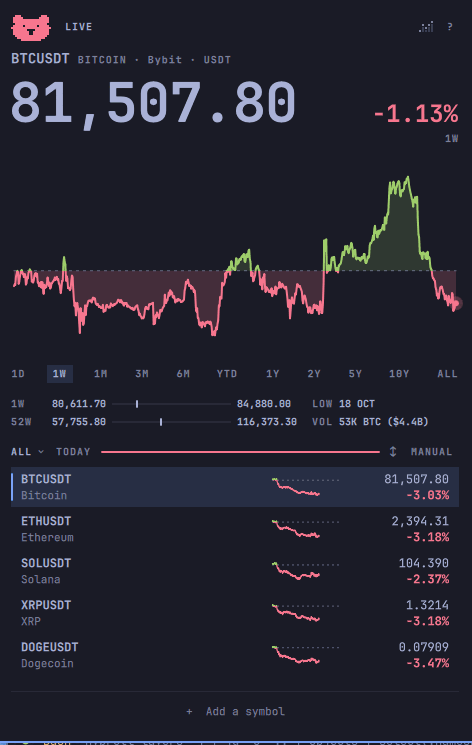
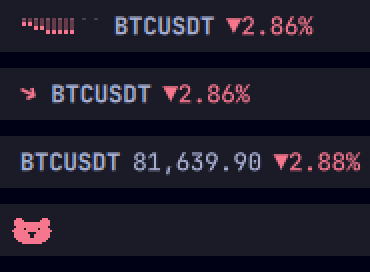
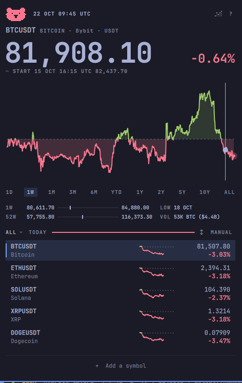
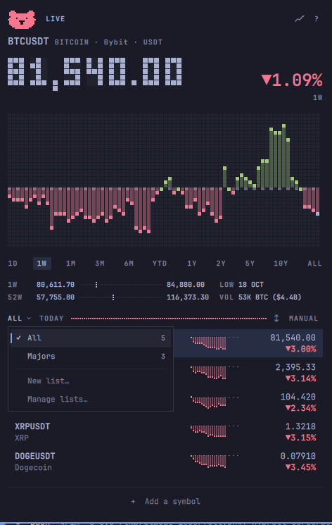
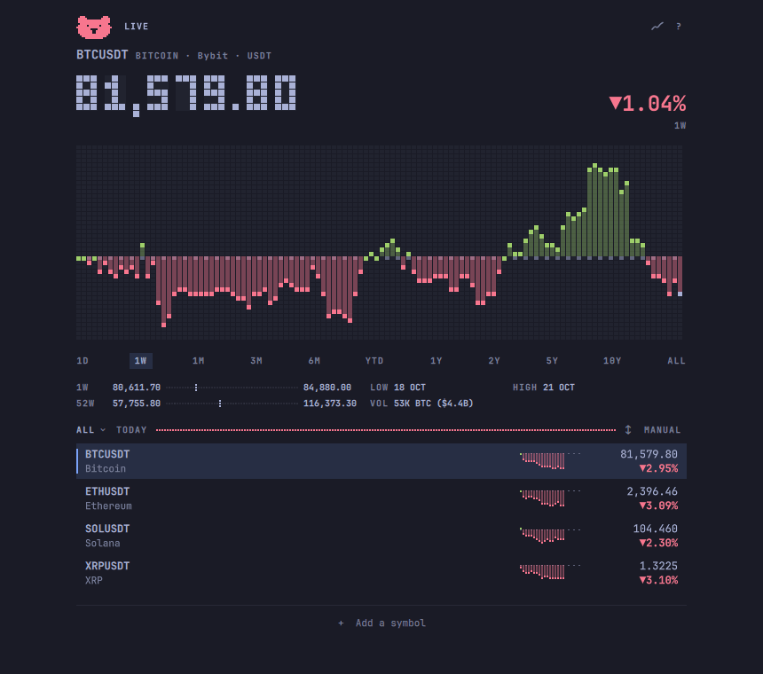
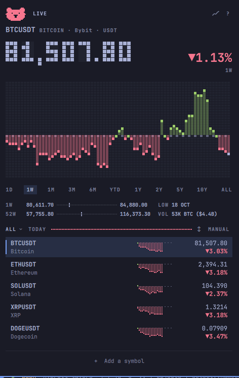

# Crypto Stonks

Crypto Stonks puts a crypto watchlist in your Omarchy 4 bar. A small pill
shows how a coin is doing today. Click it for that coin's chart and your
lists, and step through the chart to see the price at any moment on it.



- Bybit USDT perpetual futures, such as BTCUSDT, ETHUSDT, and SOLUSDT.
- Charts from one day to all time.
- The day runs from 00:00 UTC, since crypto never closes.
- Lists of your own, such as a portfolio or a theme.
- Two looks, smooth and retro, in your theme's colours.
- No account and no API key.

It doesn't track holdings, send price alerts, or show other exchanges' prices.

This is a port of [Stonks](https://github.com/gmchande/omarchy-stonks) by
Gaurav Chande, which does the same for stocks. See [Credits](#credits).

## Install

Needs Omarchy 4 and `curl` 7.84 or later, which Omarchy ships.

```sh
ln -s ~/Projects/omarchy-crypto-stonks ~/.config/omarchy/plugins/wsouto.crypto-stonks
omarchy-shell shell rescanPlugins
omarchy plugin enable wsouto.crypto-stonks center
```

That links a checkout of this folder into the shell's plugins and asks where in
the bar to put `wsouto.crypto-stonks`, which is Crypto Stonks' id. The centre
is the default. [docs/HOWTO.md](docs/HOWTO.md) has the details, and how to
update and remove it.

Crypto Stonks starts with five symbols so the pill has something to show:
BTCUSDT, ETHUSDT, SOLUSDT, XRPUSDT, and DOGEUSDT. Add your own and remove any
you don't follow.

## The pill



The pill shows today's move for the coin you last looked at, in one of four
forms: a sparkline, an arrow, the price as text, or the day's animal, the
bull on an up day and the bear on a down one. Middle-click it to change its
form. On a bar at the side of the screen it shows the animal, and a
middle-click there switches to the symbol over its change.

Point at it to read what the change is measured from. Left-click for the
popup and right-click for the window.

## Reading the day



Press `←` to step back through the chart: the price and the change follow the
cursor, and `→` steps forward. Click the bull, or on a down day the bear, to
replay the chart.

Pick a range under the chart, from 1D to ALL, with a click or `[` and `]`. The
chart then shows that range, even after a restart. The rows stay on the day's
move. On 1D, press `c` to see the change as a percent or an amount. A longer
range always shows the percent.

The change is measured from 00:00 UTC, not from Bybit's own rolling 24
hours, so the two can differ. The pill's hover and the header say so.

Under the ranges, two lines place the price between its low and high: for
the day or the range, and for the past 52 weeks. Beside them are the open
and the volume since 00:00 UTC, in the coin and in dollars, or a range's low
and high dates. A symbol younger than a range shows only its own life, so
every perpetual's 10Y and ALL look alike.

The top line says LIVE while the price is fresh. An old price says "As of"
and its time, in UTC, on its row and above the price. Old means more than two
minutes behind, or saved from the last session. A refresh that fails says so
in the same places and puts a "!" on the pill.

## Your lists



Click the list's name to switch lists, start one, or manage them. All holds
every symbol you follow, and your own lists hold some of them. Ctrl-click a
row to choose the lists it's in.

Removing a symbol from All removes it everywhere. Removing it from one of your
lists takes it out of All too, unless another list holds it. Deleting a list
does the same for its symbols. The last symbol of All stays.

Click "+ Add a symbol" and type a name or a symbol, such as `eth` or
`solusdt`. The top result shows in the chart, and Enter or a click adds it.
Search finds Bybit's USDT perpetuals: not USDC contracts, dated futures, or
stock-like contracts.

To remove a row, right-click it, or press `x` on it. The footer then says what
you removed, such as "Removed ETHUSDT". Click it, or press `u`, to bring the
row back.

The line beside the list's name shows how many rows are up, in green, and
down, in red. Click the order word to sort by symbol, name, or change, and
click its arrow to reverse the sort. In manual order, drag a row or press
`Shift+J` and `Shift+K` to move it.

## The window



Crypto Stonks also opens in a tiled window: the popup's chart and rows at the
window's width. To open it, right-click the pill or run
`omarchy-shell wsouto.crypto-stonks openWindow`. It shares the popup's lists,
range, and quotes. To float it, match class `org.quickshell` and title
`Crypto Stonks` in a window rule.

The window also works with no pill. Run
`omarchy plugin disable wsouto.crypto-stonks`, then add
`{ "id": "wsouto.crypto-stonks" }` to `plugins` in
`~/.config/omarchy/shell.json` to keep the plugin loaded. To bring the pill
back, remove that entry first, then run
`omarchy plugin enable wsouto.crypto-stonks center`.

For keys that open and close the popup and the window, add these lines to
`~/.config/hypr/bindings.lua`. Omarchy doesn't use either key by default:

```lua
o.bind("SUPER + ALT + C", "Crypto Stonks popup", "omarchy-shell shell toggle wsouto.crypto-stonks")
o.bind("SUPER + SHIFT + C", "Crypto Stonks window", "omarchy-shell wsouto.crypto-stonks toggleWindow")
```

For Crypto Stonks in the app launcher:

```sh
cp ~/.config/omarchy/plugins/wsouto.crypto-stonks/share/crypto-stonks.desktop ~/.local/share/applications/
mkdir -p ~/.local/share/icons/hicolor/scalable/apps
cp ~/.config/omarchy/plugins/wsouto.crypto-stonks/share/wsouto.crypto-stonks.svg ~/.local/share/icons/hicolor/scalable/apps/
```

## Smooth or retro



Retro draws the price in block digits and the charts in pixel columns, the
way Omarchy draws its logo. Click the small chart icon at the top right, or
press `s`, to switch between smooth and retro.

Both looks draw in your theme's colours, light themes too: up in its green
and down in its red, or in Crypto Stonks' own pair where the theme's are
missing, too alike, or too faint.

## Keys

`?` opens a sheet of the everyday keys. Every key is in this table:

| Key | Does |
| --- | --- |
| `↑` `↓` | Move the selection |
| `⏎` | Show the selected row's chart |
| `1` to `9` | Show that row's chart |
| `←` `→` | Scrub one chart step |
| `[` `]` | Change the chart range |
| `p` | Replay the chart |
| `a` or `+` | Search and add a symbol |
| `x` | Remove the selected row |
| `u` | Undo the last removal |
| Delete or Backspace | Remove the selected row (window) |
| `Shift+J` `Shift+K` | Move the selected row down or up, in manual order |
| `o` | Change the list's order |
| `Shift+O` | Reverse a sorted order |
| `w` | Open the list menu |
| `Shift+W` | Manage lists: rename, reorder, delete |
| `m` | Tick the selected row's lists |
| `,` `.` | Previous or next list |
| `c` | Show the day's change as a percent or an amount |
| `s` | Switch between smooth and retro |
| `r` | Refresh |
| `?` | Open the key sheet |
| `Esc` | Close the sheet, then the scrub, then the popup or window |

## If something's wrong

A "!" on the pill means its coin's quote is late or its last refresh failed:
point at the pill to read which. The row and the line above the price say the
same.

- **A row says "No network", "Refresh failed" or "No data for this symbol".**
  Bybit didn't answer, sent a broken answer, or has nothing for the symbol. A
  row with a price keeps it, with the time it's from. Check your connection,
  then press `r`. A symbol Bybit has delisted stays this way: remove it.
- **Everything fails with "too many requests… or Bybit is not available where
  you are".** Bybit answered 403. It does that when an IP sends too many
  requests, and to places it doesn't serve, such as the US. Crypto Stonks
  leaves Bybit alone for 10 minutes after one, and `r` won't hurry it. If you
  are somewhere Bybit doesn't serve, there is nothing to do.
- **A price looks wrong.** It is Bybit's last traded price for the USDT
  perpetual, not a spot price, and it is never converted. The change runs from
  00:00 UTC. Bybit's own "24h change" is a rolling 24 hours.
- **The header says "Loading BTCUSDT 1W".** The range's candles are on their
  way.
- **The header says "1W unavailable", with RETRY beside it.** Bybit didn't
  send that range's chart. Click RETRY, or press `r`. While Bybit is turning
  Crypto Stonks away, a range fails at once.
- **Search says "The symbol list didn't load", with RETRY beside it.** The
  list of Bybit's contracts, which search reads, didn't come. Click RETRY, or
  press Enter. Once it has come, search needs no network until the saved list
  is a day old.
- **The footer says "Can't read the data file".** The file holding your lists
  can't be opened or isn't valid JSON, often after a hand edit. Crypto Stonks
  keeps the lists it has and writes nothing over the file until it can read it
  again. Fix the file and it reads it as you save, or remove it to start over
  with the five starter symbols.

## What it runs

- **Needs:** nothing beyond Omarchy 4. It runs `curl`, which Omarchy ships.
- **Commands:** `curl` for every request. Nothing else.
- **Sites:** `api.bybit.com`, for prices, candles, and the list of contracts.
  Nothing else.
- **Data:** Bybit's public market API, which needs no key. It may change or
  stop without notice. Crypto Stonks isn't investment advice, and isn't
  affiliated with Bybit.
- **Files it writes:** your lists and settings in
  `~/.config/omarchy/wsouto.crypto-stonks.json`, and the last quotes and the
  list of contracts in `~/.cache/wsouto.crypto-stonks/`. The shell keeps the
  pill's form on its bar entry in `~/.config/omarchy/shell.json`.
- **Limits:** every request has a time limit of 10 seconds and a size cap.
  Prices refresh every minute. A row's day line comes every 5 minutes, and the
  symbol on the pill and in the popup's chart every minute. A window no screen
  shows fetches nothing. Bybit allows far more requests than this, and a
  refusal is left alone for as long as it asks.

Every request runs through the one curl command in [`Fetch.js`](Fetch.js),
which sets its limits, and only the files in [`adapters/`](adapters/) name an
exchange's endpoints. [`test/boundaries.sh`](test/boundaries.sh) fails if a
command, a file read or write, or a request turns up outside the few files
allowed them. It runs with the other checks in `bash test/check.sh`.

## Remove

```sh
omarchy plugin disable wsouto.crypto-stonks
rm ~/.config/omarchy/plugins/wsouto.crypto-stonks    # removes the link only
```

Your lists, the saved quotes, and the launcher files, if you added them, stay.
Delete what you no longer want:

```sh
rm ~/.config/omarchy/wsouto.crypto-stonks.json   # your lists; keep it to reinstall later
rm -r ~/.cache/wsouto.crypto-stonks
rm -f ~/.local/share/applications/crypto-stonks.desktop ~/.local/share/icons/hicolor/scalable/apps/wsouto.crypto-stonks.svg
```

If you added them, also delete the `{ "id": "wsouto.crypto-stonks" }` entry in
`plugins` in `~/.config/omarchy/shell.json`, and the `o.bind` lines in
`~/.config/hypr/bindings.lua`.

## Credits

The layout, the features, the keys, and much of the structure come from
**[Stonks](https://github.com/gmchande/omarchy-stonks)** by
[Gaurav Chande](https://github.com/gmchande), which shows stocks from Yahoo
Finance in the Omarchy bar. This project reuses and adapts parts of its code
and of this page under the MIT licence, and replaces its data layer with
exchange adapters. Thank you, Gaurav. The original is maintained at
<https://github.com/gmchande/omarchy-stonks>. If you want stocks, use that.

Files copied from Stonks keep their header comments, and
[docs/DIFFERENCES.md](docs/DIFFERENCES.md) lists where this project departs
from it. Both copyright lines are in [LICENSE](LICENSE).

This project is not affiliated with Stonks, Omarchy, or any exchange. It is not
investment advice.

## Contributing

How the project is built, how to run your checkout, and the checks are in
[CONTRIBUTING.md](CONTRIBUTING.md). [docs/ROADMAP.md](docs/ROADMAP.md) says
what comes next.

License: MIT, see [LICENSE](LICENSE).
